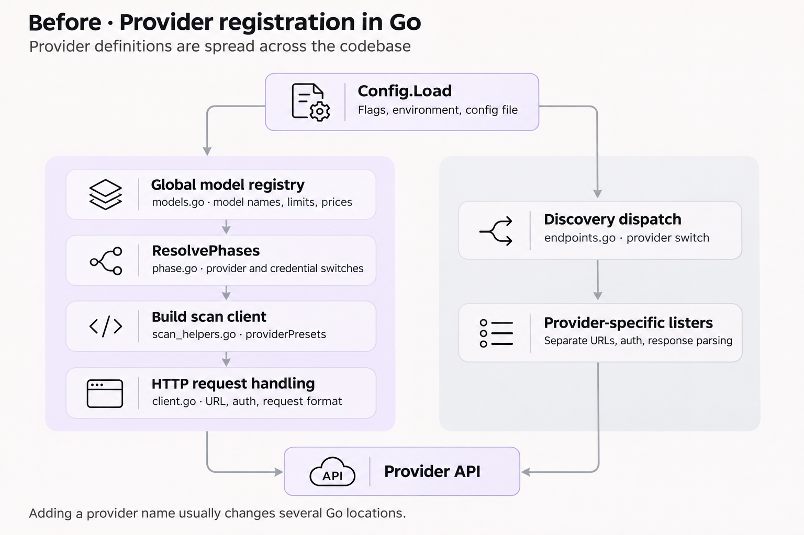
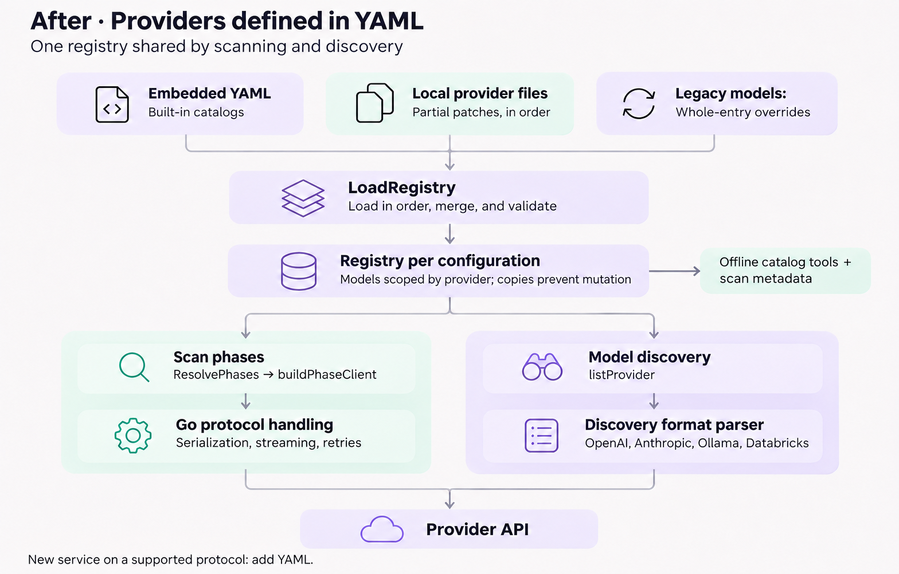

# Provider registry flow illustrations

Generated with the built-in image-generation tool. The PNGs are explanatory
illustrations; the implementation and PROVIDERS.md are the behavioral reference.
The visual style follows the user's retained engineering diagram reference.

## Before



Config.Load registers legacy model entries globally. Scan phase resolution,
client construction, HTTP request handling, and model discovery each contain
provider-specific registration. Discovery does not pass through ResolvePhases.

### Generation prompt

```text
Use case: infographic-diagram.
Asset: polished engineering architecture illustration for a GitHub pull request. Generate a single landscape diagram around 1600 x 1100 or larger at the same aspect ratio. Input image is ONLY a style reference: retain its warm near-white background, very pale lavender surfaces, charcoal sans-serif text, thin light-gray arrows, fine outline icons, generous margins. Do not copy its content or people icons. No robots, glossy 3D, gradients that reduce contrast, or saturated bars. Main text must remain legible when displayed 800 pixels wide.
Primary request: explain CodeCrucible's BEFORE code flow accurately. Title at top left exactly "Before · Provider registration in Go". Subtitle exactly "Provider definitions are spread across the codebase".
Diagram content and topology:
One top centered node "Config.Load" with small subtitle "Flags, environment, config file".
It splits into TWO separate routes, clearly arrowed down, with a pale lavender background for the left wider scan route and neutral pale-gray background for the right discovery route.
LEFT route nodes stacked in exactly this order, connected by downward arrows:
1. "Global model registry" with subtitle "models.go · model names, limits, prices"
2. "ResolvePhases" with subtitle "phase.go · provider and credential switches"
3. "Build scan client" with subtitle "scan_helpers.go · providerPresets"
4. "HTTP request handling" with subtitle "client.go · URL, auth, request format"
RIGHT route nodes stacked with spacious vertical gaps:
1. "Discovery dispatch" with subtitle "endpoints.go · provider switch"
2. "Provider-specific listers" with subtitle "Separate URLs, auth, response parsing"
The branch from Config.Load must go DIRECTLY to Discovery dispatch on the right. Discovery does NOT pass through ResolvePhases or the model registry.
Both left and right final nodes have downward connectors converging on a common bottom node "Provider API".
Short footer text exactly "Adding a provider name usually changes several Go locations."
All filenames are code labels, set smaller but readable. Simple line icons for configuration, registry, routing, code, and API. Preserve correct arrow direction and topology. No invented components.
```

## After



LoadRegistry loads embedded provider catalogs, applies ordered local patches,
and then applies legacy whole-entry model replacements. Each configuration owns
its registry. Scanning, discovery, offline catalog tools, and scan metadata
consume that definition. Go continues to implement protocol behavior.

### Generation prompt

```text
Use case: infographic-diagram.
Asset: companion engineering architecture illustration for a GitHub PR. Generate one landscape diagram around 1600 x 1100 or larger with the same aspect ratio. The input image is ONLY the visual style reference: warm near-white canvas, very pale mint and lavender rounded surfaces, charcoal sans-serif text, thin gray connectors, simple outline icons, generous margins. Match the reference visual language but replace all content. No people, mascots, glossy 3D, or saturated banners. Text legible at 800 pixels wide.
Primary request: show CodeCrucible's AFTER code flow accurately. Top-left title exactly "After · Providers defined in YAML". Subtitle exactly "One registry shared by scanning and discovery".
At top, three small source cards horizontally, in this left-to-right order:
"Embedded YAML" / subtitle "Built-in catalogs"
"Local provider files" / subtitle "Partial patches, in order"
"Legacy models:" / subtitle "Whole-entry overrides"
Each source arrow goes down to one broad centered node "LoadRegistry" / subtitle "Load in order, merge, and validate".
Arrow from LoadRegistry down to another centered node "Registry per configuration" / subtitle "Models scoped by provider; copies prevent mutation".
From this registry, split clearly into two pale mint/lavender lanes below:
LEFT lane top node "Scan phases" / subtitle "ResolvePhases → buildPhaseClient".
Arrow downward to node "Go protocol handling" / subtitle "Serialization, streaming, retries".
RIGHT lane top node "Model discovery" / subtitle "listProvider".
Arrow downward to node "Discovery format parser" / subtitle "OpenAI, Anthropic, Ollama, Databricks".
Both final nodes connect down to a shared bottom node "Provider API". Use explicit arrowheads.
A small horizontal side note beside the registry, connected to it with a thin arrow, reads "Offline catalog tools + scan metadata". Keep this note visually subordinate, do not route its arrow to Provider API.
Footer exactly "New service on a supported protocol: add YAML."
No unsupported claims that YAML implements new wire protocols; Go still owns protocol behavior. These sources feed the registry through LoadRegistry in the specified precedence. Discovery does NOT pass through Scan phases. Credentials are resolved at runtime, never stored in YAML.

```

### Final edit prompt

```text
Edit the supplied CodeCrucible After architecture diagram. Make exactly ONE change: reverse the direction of the short horizontal arrow between the central "Registry per configuration" box and the small right-side "Offline catalog tools + scan metadata" box. The arrow must point RIGHT, from the Registry box INTO the Offline catalog tools + scan metadata box. Remove the existing left-pointing arrowhead at the Registry end. The gray line should start at the right edge of Registry per configuration and end in a right-pointing arrowhead at the left edge of the small right-side box. Preserve every other node, word, title, icon, color, font, position, connection and image size unchanged.
```

